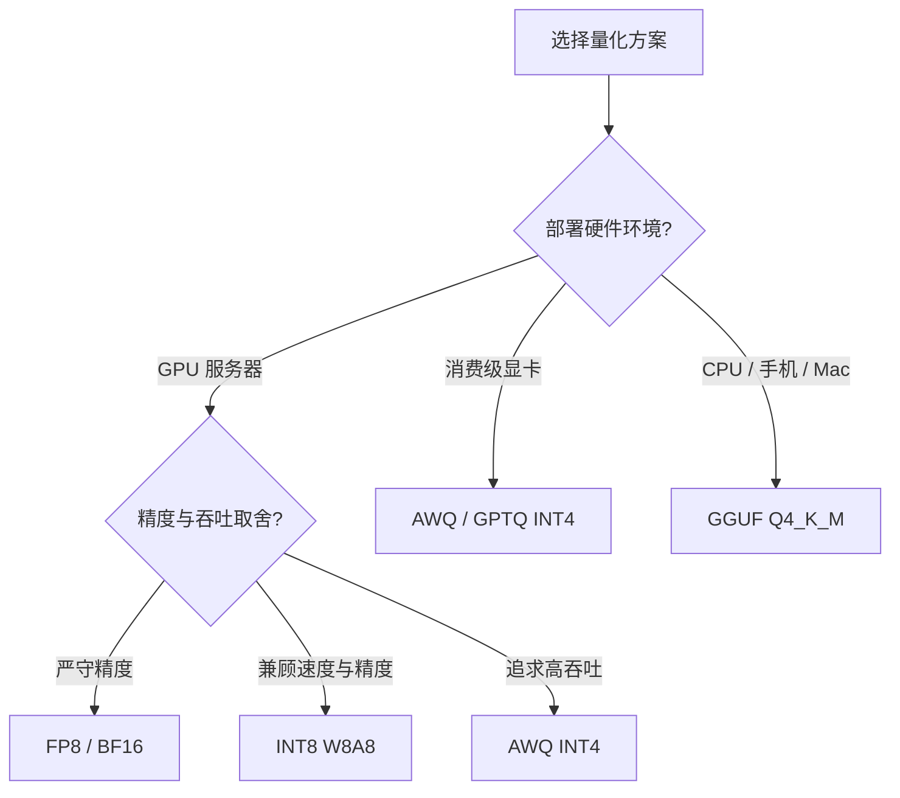

[← 上一章](06-infra.md) | [目录](../README.md) | [下一章 →](08-embedding-rag.md)

# 第七章：推理与部署

模型训练完成之后，线上推理面对的是另一套瓶颈。自回归生成分为两个阶段：Prefill 阶段并行处理输入的整段 prompt，计算量大，主要受 GPU 算力限制（Compute-Bound）；Decode 阶段逐个生成新 token，每次只算一步，主要受显存带宽限制（Memory-Bound）。本章围绕这两个阶段的性能瓶颈，介绍 KV Cache 管理、量化推理、连续批处理、投机采样和结构化输出。

## 7.1 KV Cache 与显存开销

自回归模型每生成一个新 token，都要拿它去和前面所有 token 做注意力计算。如果不保存中间结果，每走一步都要把整段历史序列重新算一遍，生成长度为 $n$ 的序列总复杂度就会达到 $O(n^2)$。

```
自回归生成时，每个新 token 需要和所有前文做 attention
朴素做法: 每次重新计算全部历史 token 的 K, V → 单步复杂度 O(n²)

KV Cache: 缓存历史算好的 K, V 矩阵，每一步只算当前新 token 的 Q, K, V
→ 单步计算复杂度降为 O(n)
→ 代价是历史状态常驻显存: 2 × layers × kv_heads × head_dim × seq_len × bytes_per_element

以 70B 模型为例 (80 层, 8 个 KV 头, head_dim=128, BF16 精度, 128K 上下文):
单个请求的 KV cache ≈ 2 × 80 × 8 × 128 × 131072 × 2 Bytes ≈ 42.95 GB
```

进入 Decode 阶段后，每一步只输入一个 token，原本的矩阵乘矩阵（GEMM）退化成了矩阵乘向量（GEMV）。这时计算单元算得极快，大部分时间都在等待数据从 HBM 显存搬运到 SRAM，算力利用率很低。序列越长、并发越高，KV Cache 占用的显存和带宽就越重。

常见的 KV Cache 缩减方法有四类：
- **GQA（分组查询注意力）**：减少 KV 头数，直接按比例压低缓存体积与带宽读取量（[见第二章](02-architecture.md#231-grouped-query-attention-gqa)）。
- **MLA（多头潜在注意力）**：把 KV 投影到低维潜在向量后再缓存，显著压低显存占用（[见第二章](02-architecture.md#233-multi-head-latent-attention-mla)）。
- **PagedAttention**：借鉴操作系统虚拟内存分页的做法，把原本要求连续存放的 KV Cache 拆成固定大小的物理块按需分配，消除预留显存带来的内部与外部碎片（[vLLM](https://github.com/vllm-project/vllm)）。
- **KV Cache 量化**：把缓存下来的 KV 从 FP16/BF16 压到 INT8 或 FP8，显存和带宽占用直接减半，对生成质量的影响很小。

## 7.2 量化推理

量化（Quantization）把原本 16 位的浮点权重或激活值压到 8 位、4 位甚至更低位宽。由于 Decode 阶段卡在显存带宽上，把权重体积缩小几倍，每次前向搬运的数据量就跟着缩小几倍，生成速度也会成倍提升。

| 方法 | 精度 | 吞吐提升 | 质量损失 | 适用场景 |
|------|------|---------|---------|-------------|
| BF16 | 16-bit | 1x（基准） | 无 | 对精度要求严苛的线上服务 |
| INT8 (W8A8) | 8-bit | ~1.8x - 2x | 极小 | 高并发线上服务 |
| FP8 (E4M3/E5M2) | 8-bit | ~2x - 2.5x | 极小 | H100 / 4090 等支持原生 FP8 的 GPU |
| INT4 ([GPTQ](https://arxiv.org/abs/2210.17323)/[AWQ](https://arxiv.org/abs/2306.00978)) | 4-bit | ~3x - 4x | 轻微 | 显存受限的显卡跑大模型（如单卡跑 70B） |
| GGUF Q4_K_M | 4-bit 混合 | ~3x - 4x | 轻微 | 本地 CPU 或 Apple Silicon 推理 |
| INT2-3 (AQLM/QuIP#) | 2-3 bit | ~5x+ | 较明显 | 显存极度受限的实验环境 |

常用量化方法的思路差异：
- **GPTQ**：属于后训练量化（PTQ）。它拿一小批校准数据算海森矩阵（Hessian）的逆，按列逐个量化权重，同时把当前列产生的量化误差分摊补偿到后面还没量化的权重上。
- **AWQ（Activation-aware Weight Quantization）**：观察到权重里大约只有 1% 的通道对模型输出影响最大，而这些通道正好对应激活值幅值较大的维度。AWQ 在量化前按激活值大小对权重做逐通道缩放，保护这部分关键权重不被粗粒度截断。
- **GGUF**：[llama.cpp](https://github.com/ggerganov/llama.cpp) 使用的混合精度分块量化格式，支持把不同层切分到 CPU 内存和 GPU 显存上协同推理。

### 怎么选量化方法



## 7.3 推理框架

直接用 HuggingFace Transformers 的 `generate` 跑线上服务，显存利用率和并发吞吐都很低。生产环境通常会用专门的推理引擎，把算子融合（Kernel Fusion）、显存分页和动态调度打包做好。

| 框架 | 特点 | 适用场景 |
|------|------------|-------------|
| [**vLLM**](https://github.com/vllm-project/vllm) | PagedAttention，Continuous Batching，生态成熟 | 生产环境部署首选 |
| [**TensorRT-LLM**](https://github.com/NVIDIA/TensorRT-LLM) | NVIDIA 官方深度优化 CUDA 算子与 FP8 | 在 NVIDIA GPU 上压榨最高吞吐 |
| [**SGLang**](https://github.com/sgl-project/sglang) | RadixAttention 前缀树缓存，结构化输出极快 | 多轮对话、复杂 Prompt 与 Agent |
| [**llama.cpp**](https://github.com/ggerganov/llama.cpp) | 纯 C/C++ 实现，无外部依赖，支持 CPU 与 Apple Silicon | 本地轻量化推理 |
| [**MLC-LLM**](https://github.com/mlc-ai/mlc-llm) | 基于 TVM 编译优化，支持多平台部署 | 手机、浏览器与端侧设备 |
| [**Ollama**](https://ollama.com/) | 封装 llama.cpp，提供类似 Docker 的命令行体验 | 个人本地快速上手 |

### vLLM 快速部署

```bash
# 安装
pip install vllm

# 启动兼容 OpenAI 协议的 API 服务
vllm serve meta-llama/Llama-3-8B-Instruct \
    --dtype bfloat16 \
    --max-model-len 8192 \
    --gpu-memory-utilization 0.9

# 调用测试 (与 OpenAI API 格式一致)
curl http://localhost:8000/v1/chat/completions \
    -H "Content-Type: application/json" \
    -d '{"model": "meta-llama/Llama-3-8B-Instruct", "messages": [{"role": "user", "content": "Hello"}]}'
```

### 连续批处理（Continuous Batching）

传统的静态批处理（Static Batching）必须等同一个 batch 里最长的那个请求生成完，整批请求才能一起退场。短请求早早生成完，也只能填充空白（Padding）干等，白白占着显存和算力。连续批处理把调度粒度从“按请求对齐”改成了“按生成步对齐”：每往前走一步，已完成的请求立刻退出并释放显存，排队的请求随时插进来。

```
传统 Static Batching:
  请求 A (100 tokens) ─────────────────────────▶ 结束
  请求 B (30 tokens)  ──────────▶ 完成 [空等 A 结束...]
  请求 C (50 tokens)  ────────────────▶ 完成 [空等 A 结束...]
  → B 和 C 生成完后仍在占用位置，GPU 算力大量闲置

Continuous Batching (vLLM / TensorRT-LLM):
  请求 A ─────────────────────────▶ 结束
  请求 B ──────────▶ 完成 → 立即插入请求 D ─────▶ 结束
  请求 C ────────────────▶ 完成 → 立即插入请求 E ──▶
  → 请求随完随走、随到随插，GPU 持续满载运行
```

## 7.4 投机采样（Speculative Decoding）

投机采样（[Leviathan et al., 2023](https://arxiv.org/abs/2211.17192)）利用“大模型串行生成一个 token 和并行验证一串 token 耗时差不多”这一硬件特性，用小模型帮大模型探路。

```
瓶颈: LLM 自回归生成卡在显存带宽上，每次把权重从显存搬过来只算 1 个 token，算力空转。
思路: 先用小模型 (Draft Model) 快速连猜 K 个 token，
      再让大模型 (Target Model) 只做一次前向传播，并行算出这 K 个位置的概率分布做验证。

Draft model: 快速生成候选序列 [t1, t2, t3, t4, t5] (5 个 token)
Target model: 一次前向并行验证 → 接受 t1, t2, t3，拒绝 t4 → 从 t3 之后直接用大模型的分布重采样修正

结果: 大模型只花一次前向传播的时间，实际推进了多个 token。
      生成速度提升 2-3 倍，同时通过拒绝采样保证最终输出的分布与大模型单独生成完全一致。
```

除了外挂独立的小模型，后续工作还发展出不需要单独训小模型的方案：
- **EAGLE**（[Li et al., 2024](https://arxiv.org/abs/2401.15077)）：直接拿目标模型倒数第二层的隐藏状态特征，接一个极轻量的草稿头预测后续 token，比独立小模型猜得更准，加速比可达 3 倍以上。
- **Medusa**（[Cai et al., 2024](https://arxiv.org/abs/2401.10774)）：在原模型顶部多挂几个预测头，每个头负责猜未来第 $k$ 个位置的词，再用树状注意力一次验证多条候选分支。

## 7.5 结构化输出（Structured Generation）

做 Agent 工具调用或信息抽取时，下游代码通常要求模型返回严格合法的 JSON 或特定格式，多吐一句解释或者少一个引号都会导致解析报错。

### 7.5.1 JSON Mode 与约束解码

**方法 1：推理时约束解码（Constrained Decoding）**
推理引擎根据给定的 JSON Schema 维护一个状态机。每一步采样前，先把不符合当前语法状态的 token logit 置为 $-\infty$，从根本上阻止模型采样出破坏格式的字符。

```python
# vLLM / SGLang 原生支持传入 JSON Schema 约束
from pydantic import BaseModel

class WeatherQuery(BaseModel):
    city: str
    unit: str = "celsius"

# 模型在采样阶段被限制只能输出符合 Schema 的合法 JSON
response = client.chat.completions.create(
    model="llama-3-8b-instruct",
    messages=[{"role": "user", "content": "What's the weather in Stockholm?"}],
    response_format={
        "type": "json_schema",
        "json_schema": WeatherQuery.model_json_schema()
    }
)
```

**方法 2：引导生成（[Outlines](https://github.com/dottxt-ai/outlines)）**
Outlines 会把正则表达式或 Pydantic 模型预先编译成确定性有限状态自动机（DFA），推理时每步只用查表就能掩码掉非法 token，几乎不增加额外延迟。

```python
import outlines

model = outlines.models.transformers("meta-llama/Llama-3-8B-Instruct")
generator = outlines.generate.json(model, WeatherQuery)
result = generator("What's the weather in Stockholm?")
# 返回合法的实例: WeatherQuery(city='Stockholm', unit='celsius')
```

**方法 3：正则与上下文无关文法（CFG）工具**
- **[Outlines](https://github.com/dottxt-ai/outlines)**：支持正则表达式、JSON Schema 和上下文无关文法（CFG）。
- **[LMQL](https://github.com/eth-sri/lmql)**：类似 SQL 的声明式查询语言，可穿插编写提示词与输出约束条件。
- **[Guidance](https://github.com/guidance-ai/guidance)**：支持模板化控制流与正则约束，把固定模板直接填进上下文，省去模型自己生成固定字段的时间。

### 7.5.2 Function Calling

模型本身并不会直接执行外部代码。Function Calling 的做法是把可用工具的名称、用途和参数 Schema 写进系统提示词，模型判断需要调工具时，按约定格式吐出函数名与参数 JSON，由外层程序执行后再把结果塞回对话。

```python
tools = [{
    "type": "function",
    "function": {
        "name": "get_weather",
        "description": "Get current weather",
        "parameters": {
            "type": "object",
            "properties": {
                "city": {"type": "string"},
                "unit": {"type": "string", "enum": ["celsius", "fahrenheit"]}
            },
            "required": ["city"]
        }
    }
}]

response = client.chat.completions.create(
    model="gpt-4",
    messages=[{"role": "user", "content": "Weather in Stockholm?"}],
    tools=tools,
)
# 模型输出工具调用参数: {"name": "get_weather", "arguments": {"city": "Stockholm", "unit": "celsius"}}
```

## 7.6 成本估算

### 7.6.1 训练成本公式

稠密模型预训练的总浮点计算量大约是 $6ND$（前向传播约 $2ND$，反向传播约 $4ND$）。结合显卡标称算力与实际模型浮点利用率（MFU），可以快速估算训练耗时与账单：

$$T_{\text{hours}} \approx \frac{6 \times N \times D}{\text{GPU\_FLOPS} \times \text{MFU} \times n_{\text{GPUs}} \times 3600}$$

$$\text{Cost} = T_{\text{hours}} \times n_{\text{GPUs}} \times P_{\text{GPU-hour}}$$

```
参数含义:
N = 模型参数量
D = 训练总 Token 数
GPU_FLOPS = 单卡 BF16 峰值算力 (如 H100 SXM 约为 989 TFLOPS)
MFU = 实际算力利用率 (通常在 0.35 - 0.50 之间)
P_GPU-hour = 单卡每小时租价

举例: 用 8 张 H100 训练一个 7B 模型，数据量 1T tokens:
总计算量 = 6 × 7e9 × 1e12 = 4.2e22 FLOPs
8 卡实际算力 = 989e12 × 0.40 × 8 = 3.16e15 FLOPs/s
耗时 = 4.2e22 / (3.16e15 × 3600) ≈ 3691 单卡小时 / 8 ≈ 461 小时 ≈ 19.2 天 (8 卡并行)
总成本: 19.2 天 × 24 小时 × 8 卡 × $3.5 / 卡时 ≈ $12,900
```

### 7.6.2 GPU 云价格参考（2025/2026）

| GPU | 按需价格 | 预留价格 | 硬件规格 | 常见平台 |
|-----|---------|---------|---------|------|
| A100 80GB | ~$2.0/hr | ~$1.2/hr | 80GB HBM2e, NVLink 600GB/s | Lambda, RunPod |
| H100 SXM | ~$3.5/hr | ~$2.0/hr | 80GB HBM3, NVLink 900GB/s | Lambda, AWS p5 |
| H200 SXM | ~$4.5/hr | ~$2.8/hr | 141GB HBM3e, 4.8TB/s 带宽 | CoreWeave |
| RTX 4090 | ~$0.5/hr | ~$0.3/hr | 24GB GDDR6X, PCIe 4.0 | vast.ai, RunPod |

> 云平台价格随供需波动较大，包月或长期预留通常比按需租用便宜 40%-60%。

### 7.6.3 推理指标与降本手段

线上推理主要看四个指标：
- **TTFT（Time-to-First-Token，首字延迟）**：用户发出请求到看见第一个字的时间，取决于 Prefill 阶段算得有多快。
- **TPOT（Time-per-Output-Token，单字生成耗时）**：决定后续吐字流不流畅，主要取决于 Decode 阶段的显存带宽。
- **吞吐量（Tokens/s）**：整台机器每秒总共能产出多少 token，直接决定单次请求的摊销成本。
- **百万 Token 成本（$/1M Tokens）**：通常把输入（Prefill）和输出（Decode）分开计价，输出 token 因为占带宽久，单价往往是输入的 3 到 5 倍。

常用的推理降本做法：
1. **量化（FP8 / INT4）**：显存占用减半甚至降到四分之一，同一张卡能塞下更大的并发 batch，吞吐翻倍。
2. **前缀缓存（Prefix Caching）**：多轮对话或长 System Prompt 的前文 KV Cache 直接复用，不用每次请求都重新做一遍 Prefill。
3. **连续批处理（Continuous Batching）**：用 vLLM 或 SGLang 替代原生脚本，把 GPU 利用率提上来。
4. **大小模型分流**：用轻量分类器把简单任务分给 7B/8B 小模型，复杂推理再调 70B 或旗舰模型。
5. **投机采样（Speculative Decoding）**：在并发不高、显卡算力有富余时，用小模型打草稿减少大模型前向次数。

## 关键论文

- [Kwon et al. (2023): vLLM / PagedAttention](https://arxiv.org/abs/2309.06180)：用分页机制管理 KV Cache，大幅消除显存碎片并提升并发吞吐。
- [Leviathan et al. (2023): Speculative Decoding](https://arxiv.org/abs/2211.17192)：小模型草稿加Target模型并行验证的无损加速方案。
- [Cai et al. (2024): Medusa](https://arxiv.org/abs/2401.10774)：在单模型上加多个预测头实现并行投机解码。
- [Frantar et al. (2022): GPTQ](https://arxiv.org/abs/2210.17323)：利用二阶海森矩阵信息做误差补偿的 4-bit 后训练量化。
- [Lin et al. (2023): AWQ](https://arxiv.org/abs/2306.00978)：根据激活值分布保护关键权重通道的 4-bit 量化方案。

## 进一步阅读

- [vLLM](https://github.com/vllm-project/vllm) / [SGLang](https://github.com/sgl-project/sglang) / [TensorRT-LLM](https://github.com/NVIDIA/TensorRT-LLM)：主流开源推理引擎对比。
- [llama.cpp](https://github.com/ggerganov/llama.cpp)：CPU 与端侧推理实现参考。
- Hao Zhang: [Towards 100x Speedup: Full Stack Transformer Inference Optimization](https://yaofu.notion.site/Towards-100x-Speedup-Full-Stack-Transformer-Inference-Optimization-43124c3688e14cffaf2f1d6cbdf26c39)

## 练习题

1. **吞吐对比**：选同一个模型（如 Qwen2.5-7B），分别用 HuggingFace `generate`、vLLM 和 SGLang 跑 100 并发请求，记录各自的 TTFT、TPOT 和总吞吐（tokens/s）。
2. **量化精度评测**：把 Llama-3-8B 分别用 AWQ 和 GPTQ 量化到 4-bit，在 MMLU 和 GSM8K 上测试分数变化与显存节省比例。
3. **投机采样实战**：用 Llama-3-8B 作目标模型，同系列的 1B 模型作草稿模型，测试不同类型 prompt 下的 token 接受率（Acceptance Rate）和实际加速比。

---

[← 上一章](06-infra.md) | [目录](../README.md) | [下一章 →](08-embedding-rag.md)
