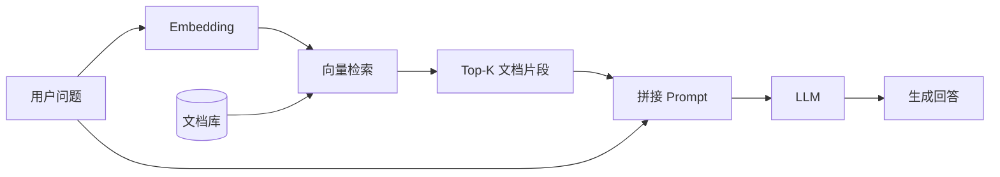

[← 上一章](07-inference.md) | [目录](../README.md) | [下一章 →](09-multimodal.md)

# 第八章：Embedding 模型与 RAG

大语言模型训练完后，参数里的知识就固定在了训练截止日期，面对私有文档或最新信息时容易胡编乱造（幻觉）。检索增强生成（RAG, Retrieval-Augmented Generation）先从外部知识库里检出相关文档片段，再塞进上下文让模型作答。支撑这套检索流程的底座，是把文本变成向量的 Embedding 模型与向量数据库。

## 8.1 文本 Embedding

### 8.1.1 什么是文本 Embedding

Embedding 模型把一段不定长的文本映射成固定维度的稠密向量（例如 $\mathbf{e} \in \mathbb{R}^{768}$ 或 $\mathbb{R}^{1024}$）。训练好的向量空间里，意思相近的句子夹角小（余弦相似度高），意思无关的句子距离远。

```
"The cat sat on the mat"    → [ 0.12, -0.34,  0.56, ...] ∈ ℝ^768
"A kitten is on the rug"    → [ 0.11, -0.32,  0.55, ...] ← 距离近，余弦相似度高
"Stock prices rose sharply" → [ 0.87,  0.23, -0.45, ...] ← 距离远，余弦相似度低
```

常见的用处包括：语义搜索、文档召回、聚类去重、文本分类、推荐召回和 RAG。

### 8.1.2 训练方法与对比学习

主流 Embedding 模型普遍采用双塔结构（Bi-Encoder），通过对比学习（Contrastive Learning）训练。它的损失函数通常是 InfoNCE：给定一个查询（query），把正样本（positive）的向量拉近，同时把同一批次里的其他样本及显式构造的负样本（negatives）推远。

```python
# InfoNCE Loss (对比学习)
# 目标: 拉近正样本对 (query, positive)，推远负样本对 (query, negative)

def infonce_loss(query, positive, negatives, temperature=0.05):
    pos_sim = cos_sim(query, positive) / temperature
    neg_sims = cos_sim(query, negatives) / temperature
    return -log(exp(pos_sim) / (exp(pos_sim) + sum(exp(neg_sims))))
```

训练数据的正样本对可以从多种来源收集：

| 正样本来源 | 构造方式 | 适用阶段 |
|---------|---------|-------------|
| 标题-正文 | 标题作 query，正文段落作 positive | 大规模弱监督预训练 |
| 问答对（QA） | 用户问题对应标准解答段落 | 检索微调 |
| 翻译平行语料 | 源语言句子对应目标语言译文 | 跨语言语义对齐 |
| 自然语言推理（NLI） | 前提句与蕴含句（entailment）配对 | 句向量语义对齐 |
| LLM 合成数据 | 用大模型针对特定文档生成问题与查询对 | 垂直领域冷启动与增强 |

**难负样本（Hard Negatives）**对训练效果影响极大。如果只拿同 batch 里随机抽到的其他文档当负样本，模型很容易靠抓几个表面关键词就蒙混过关。工程上通常会先用 BM25 或旧版向量模型搜出那些“字面词高度重合、但其实答非所问”的文档作为难负样本，逼着模型去分辨深层语义差别。

### 8.1.3 多阶段训练流程

高质量开源 Embedding 模型（如 BGE、GTE、E5）通常分两到三个阶段训练：

```
Stage 1: 大规模弱监督对比预训练
  - 数据: 亿级网页标题-正文对、论坛问答、锚文本
  - 目的: 用超大 Batch Size 打底，学会通用的基础语义表示

Stage 2: 高质量多任务微调
  - 数据: 几十万人工标注的检索数据、NLI、STS 数据集
  - 目的: 加入任务指令前缀 (Instruction)，引入难负样本，拉高检索精度

Stage 3 (可选): 知识蒸馏
  - 让参数量更大或精度更高的 Cross-Encoder 给候选样本打软标签，教双塔模型逼近精排分数的排序分布
```

### 8.1.4 主流 Embedding 模型

新一代 Embedding 模型广泛引入了俄罗斯套娃表征学习（Matryoshka Representation Learning, MRL）。训练时同时对向量的前 256、512、1024 直至完整维度算损失，让靠前的维度集中承载最重要的语义信息。这样线上部署时可以直接截断只取前 512 维，省下大半内存，而检索精度几乎不掉。

| 模型 | 维度 | 上下文长度 | 特点 |
|------|------|--------|------|
| [text-embedding-3-large](https://platform.openai.com/docs/guides/embeddings) (OpenAI) | 3072（支持 MRL） | 8K | 商用 API 常用基线，支持按需截断维度 |
| [Voyage-3](https://www.voyageai.com/) | 1024 | 32K | 代码、法律与金融领域检索效果突出 |
| [BGE-M3](https://huggingface.co/BAAI/bge-m3) (BAAI) | 1024 | 8K | 支持中英等多语言，同时输出稠密、稀疏与多向量表征 |
| [GTE-Qwen2](https://huggingface.co/Alibaba-NLP/gte-Qwen2-7B-instruct) (Alibaba) | 3584 | 128K | 基于 Qwen2-7B 基座，长文本与指令理解能力强 |
| [E5-Mistral-7B](https://arxiv.org/abs/2401.00368) | 4096 | 32K | 用自回归大模型底座改造出的大参数向量模型 |
| [NV-Embed-v2](https://huggingface.co/nvidia/NV-Embed-v2) (NVIDIA) | 4096 | 32K | 引入 Latent Attention Pooling，在 MTEB 榜单长期居前 |
| [nomic-embed-text](https://huggingface.co/nomic-ai/nomic-embed-text-v1.5) | 768（支持 MRL） | 8K | 完全开源训练数据与代码，小巧轻快 |

> 评测榜单参考：[MTEB (Massive Text Embedding Benchmark)](https://huggingface.co/spaces/mteb/leaderboard)

### 8.1.5 微调自己的 Embedding 模型

用 [sentence-transformers](https://github.com/UKPLab/sentence-transformers) 可以在私有业务语料上快速微调开源向量模型：

```python
from sentence_transformers import SentenceTransformer, InputExample, losses
from torch.utils.data import DataLoader

model = SentenceTransformer("BAAI/bge-base-en-v1.5")

train_examples = [
    InputExample(texts=["What is KV Cache?", "KV Cache stores past key-value states to speed up autoregressive decoding."]),
    InputExample(texts=["What is LoRA?", "Low-Rank Adaptation freezes base weights and updates low-rank matrices."]),
]

train_dataloader = DataLoader(train_examples, shuffle=True, batch_size=16)

# MultipleNegativesRankingLoss 会自动把同 batch 内的其他正样本作为负样本计算 InfoNCE
train_loss = losses.MultipleNegativesRankingLoss(model)

model.fit(
    train_objectives=[(train_dataloader, train_loss)],
    epochs=3,
    warmup_steps=100,
)
```

## 8.2 向量检索与近似最近邻（ANN）

当文档库只有几万条时，直接拿查询向量跟库里所有向量挨个算内积（暴力搜索）也只需几毫秒。但到了百万、亿级规模，$O(N \cdot d)$ 的全量扫描就跑不动了，必须借用近似最近邻（ANN, Approximate Nearest Neighbor）索引，用一点点召回精度换取成百上千倍的查询加速。

### 8.2.1 向量数据库选型

| 数据库/库 | 类型 | 特点 | 适用场景 |
|--------|------|------|-------------|
| [FAISS](https://github.com/facebookresearch/faiss) (Meta) | C++/Python 库 | 检索最快，支持 GPU 加速，但不带数据库存储与管理功能 | 底层算法研发、离线批处理检索 |
| [Milvus](https://github.com/milvus-io/milvus) | 分布式数据库 | 存算分离，支持百亿级向量水平扩展 | 大规模企业级生产环境 |
| [Qdrant](https://github.com/qdrant/qdrant) | 独立服务 | Rust 编写，内存占用省，带标量条件过滤（Payload Filter）极快 | 常用生产环境检索服务 |
| [Weaviate](https://github.com/weaviate/weaviate) | 独立服务 | 支持 GraphQL 接口，内置混合检索模块 | 快速搭建检索应用 |
| [ChromaDB](https://github.com/chroma-core/chroma) | 嵌入式库 | Python `pip install` 即用，零配置 | 本地开发调试、小规模原型 |
| [Pinecone](https://www.pinecone.io/) | 云托管服务 | Serverless 免运维，按量计费 | 不想自己维护基础设施的团队 |
| [pgvector](https://github.com/pgvector/pgvector) | PostgreSQL 插件 | 向量和业务关系表放在同一个库里，支持事务 | 已有 PostgreSQL 且向量规模在百万级以内 |

### 8.2.2 常用向量索引类型

```
暴力搜索 (Flat):
  逐个算余弦或点积，100% 精确，但复杂度 O(N)，只适合 10 万条以内的数据

IVF (Inverted File Index, 倒排乘积索引):
  先用 K-Means 把向量空间聚成 K 个簇，查询时只去离 query 最近的几个簇里找
  速度: O(N/K)，召回率: ~95%-99%

HNSW (Hierarchical Navigable Small World, 分层小世界图):
  构建多层近邻图，顶层边长跨度大用来快速跳进目标区域，底层密集用来精细搜索
  查询极快 O(log N)，召回率高 (>98%)，缺点是很吃内存
  → 目前生产环境最常用的默认索引

PQ (Product Quantization, 乘积量化):
  把高维向量切成多个短的子向量，各自聚类量化成码本编号
  内存占用可压缩 32-64 倍，但有一定精度损失
  → 常与 IVF 或 HNSW 组合 (如 IVF_PQ)，用于千万到十亿级规模

经验选型:
  < 100K 文档: Flat (直接暴力搜索)
  100K - 10M 文档: HNSW
  > 10M 文档或内存受限: IVF_PQ 或 HNSW + Scalar/Product Quantization
```

## 8.3 检索增强生成（RAG）

### 8.3.1 基本流程

RAG 的核心流程只有三步：先把文档切块转成向量存起来；用户提问时把问题也转成向量，去库里搜出最相关的前 $K$ 个片段；最后把这些片段连同问题一起拼进 Prompt 喂给 LLM。



```python
# 最简 RAG 实现
import openai
import chromadb

chroma_client = chromadb.Client()
collection = chroma_client.create_collection("docs")

# 1. 文档向量化入库
for doc_id, doc in enumerate(documents):
    embedding = openai.embeddings.create(input=doc, model="text-embedding-3-small")
    collection.add(documents=[doc], embeddings=[embedding.data[0].embedding], ids=[str(doc_id)])

# 2. 检索 + 拼接生成
query = "What is the company's return policy?"
query_emb = openai.embeddings.create(input=query, model="text-embedding-3-small").data[0].embedding
results = collection.query(query_embeddings=[query_emb], n_results=5)

prompt = f"""Answer based strictly on the following context:

{chr(10).join(results['documents'][0])}

Question: {query}"""

response = openai.chat.completions.create(
    model="gpt-4",
    messages=[{"role": "user", "content": prompt}]
)
```

### 8.3.2 RAG 常见问题与优化手段

直接搭出来的朴素 RAG 往往效果平平，问题大多出在切分不合理或检索漏掉了关键信息：

```
问题 1: 检索不准 (特别是遇到专有名词、错误码、缩写时)
  → 混合检索 (Hybrid Search): 向量检索 (抓语义) + BM25 关键词检索 (抓精确字面匹配)，用 RRF (倒数秩融合) 合并排序
  → 重排序 (Reranker): 先粗搜召回 Top-100，再用 Cross-Encoder 精排出 Top-5
  → 查询改写 (Query Rewriting / HyDE): 让 LLM 把用户的口语短问题改写成完整查询，或先生成一段假想答案再去搜相似文档

问题 2: 文档切块 (Chunking) 切断了上下文
  → 保留重叠 (Overlap): 按固定长度切分时保留 10%-20% 的重叠窗口
  → 递归结构切分: 优先按 Markdown 标题、段落、句号层级切分，别在句子中间硬截断
  → 父子块检索 (Small-to-Big): 拿细粒度的小句子块 (如 100 tokens) 建索引做匹配，命中后把包裹它的整段父文档 (如 800 tokens) 抽出来喂给 LLM

问题 3: 模型不按检索结果回答，或者照样编造
  → 引用标注: 要求模型每句话后面标出引用了第几个文档片段 [1][2]
  → 拒答兜底: 在 Prompt 里写明“如果提供的上下文中没有答案，请直接回答不知道，不要推测”
```

### 8.3.3 进阶架构：Reranker 与 Agentic RAG

**二阶段检索（Bi-Encoder + Cross-Encoder Reranker）**：
双塔模型（Bi-Encoder）把 query 和文档分开独立编码，虽然算点积很快，但 query 和文档里的词没有做过直接的交叉注意力，细微逻辑容易看走眼。因此在生产系统中，通常加上第二阶段重排：

```
Stage 1: Bi-Encoder 粗召回 (快，从百万文档里捞出 Top-100)
  query → 向量, doc → 向量，直接算余弦相似度

Stage 2: Cross-Encoder 精排 (慢但准，从 Top-100 里挑出 Top-5)
  把 [query, doc] 拼成一条序列喂进 Transformer，让所有词做全注意力交互，直接输出相关性分数

常用 Reranker 模型:
  - BAAI/bge-reranker-v2-m3
  - Cohere Rerank
  - jina-reranker-v2-base-multilingual
```

**Agentic RAG**：
传统 RAG 不管用户问什么，固定走“搜一次 → 答一次”的单向流水线。Agentic RAG 把检索器当成一个可调用的工具（Tool）交给模型，由模型自己决定：
- 这个问题需不需要查库？（闲聊或常识问题直接答）
- 复杂问题要不要拆成几个子问题分步去查？（多跳检索 Multi-Hop）
- 搜出来的东西如果不相关，要不要换个关键词重搜一次？（Self-RAG / Corrective RAG）

### 8.3.4 RAG 常用框架

| 框架 | 特点 |
|------|------|
| [LangChain](https://github.com/langchain-ai/langchain) | 社区生态大，集成组件最全，但封装层级较深 |
| [LlamaIndex](https://github.com/run-llama/llama_index) | 专注于文档解析、树状/图状索引与检索编排 |
| [Haystack](https://github.com/deepset-ai/haystack) | 管道式（Pipeline）设计清晰，适合生产环境落地 |
| 直接手写 | 推荐优先尝试。RAG 核心逻辑其实就是 `embed → search → prompt`，自己用百来行代码写更容易调试 |

### 8.3.5 RAG vs 微调 vs 长上下文

| 方法 | 适用场景 | 优势 | 劣势 |
|------|---------|------|------|
| **RAG** | 知识频繁更新、私有数据、要求给出原文引用来源 | 新增数据秒级生效、推理成本低、支持按用户做文档权限隔离 | 效果上限受限于切分与检索召回质量 |
| **微调（Fine-Tuning）** | 调整说话语气、固定输出格式、学习特定领域推理习惯 | 推理时不用带长串检索上下文，响应快 | 知识写死在权重里，难以增删更新，也压不住事实幻觉 |
| **长上下文（Long Context）** | 一次性针对几篇财报或整个中小型代码库做全局问答 | 不用折腾切块和向量库，信息无损 | 每次请求都要重算海量 Prefill，成本高、首字延迟长 |

在实际项目里，这三种方法往往配合使用：用微调教会模型固定格式与领域黑话，用 RAG 从大库里捞出几十页相关资料，再靠长上下文窗口把捞出来的完整章节一次性读完作答。

## 关键论文

- [Devlin et al. (2018): BERT](https://arxiv.org/abs/1810.04805)：双向 Transformer 编码器与早期的文本表征基座。
- [Reimers & Gurevych (2019): Sentence-BERT](https://arxiv.org/abs/1908.10084)：用孪生双塔网络训练高质量句向量的奠基工作。
- [Karpukhin et al. (2020): DPR (Dense Passage Retrieval)](https://arxiv.org/abs/2004.04906)：用稠密向量检索替代传统 BM25 做开放域问答。
- [Khattab & Zaharia (2020): ColBERT](https://arxiv.org/abs/2004.12832)：保留每个 token 的向量做延迟交互（Late Interaction），兼顾双塔速度与交叉注意力精度。
- [Lewis et al. (2020): Retrieval-Augmented Generation (RAG)](https://arxiv.org/abs/2005.11401)：提出检索增强生成框架的原始论文。

## 进一步阅读

- [FlagEmbedding (BGE 系列)](https://github.com/FlagOpen/FlagEmbedding)：开源 Embedding 与 Reranker 模型与训练工具包。
- [LlamaIndex](https://github.com/run-llama/llama_index) / [LangChain](https://github.com/langchain-ai/langchain)：主流 RAG 编排框架。
- [Chroma](https://www.trychroma.com/) / [Qdrant](https://qdrant.tech/) / [Milvus](https://milvus.io/)：向量数据库文档与选型指南。

## 练习题

1. **Embedding 召回对比**：在你的私有文档集上，对比 `BGE-large-zh`（或 `BGE-M3`）与 OpenAI `text-embedding-3-large` 的 Recall@5 指标。
2. **Chunking 消融实验**：固定向量模型，对比切块大小（256 / 512 / 1024 tokens）与重叠窗口（0 / 64 / 128 tokens）对最终问答准确率的影响。
3. **混合检索实现**：结合 BM25 与稠密向量检索，用倒数秩融合（RRF）合并两路结果，测试它在包含大量专有名词或型号代码的查询上比纯向量检索提升多少。

---

[← 上一章](07-inference.md) | [目录](../README.md) | [下一章 →](09-multimodal.md)
